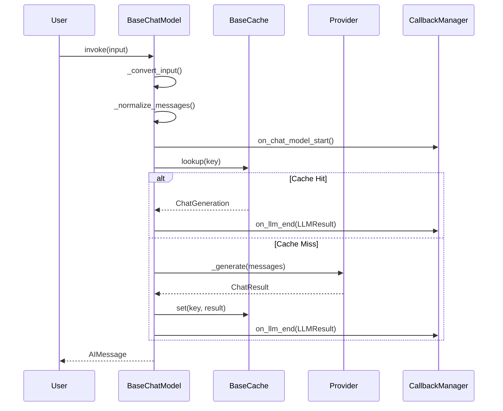
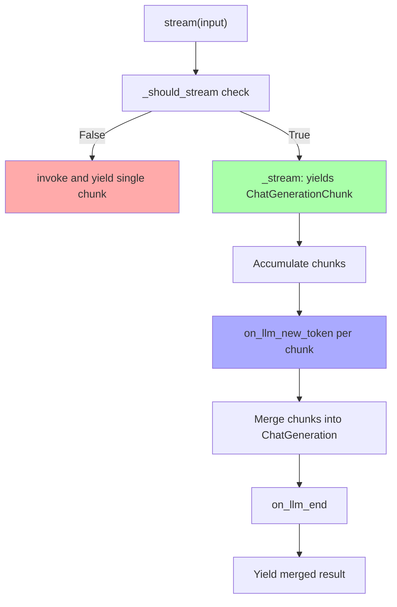
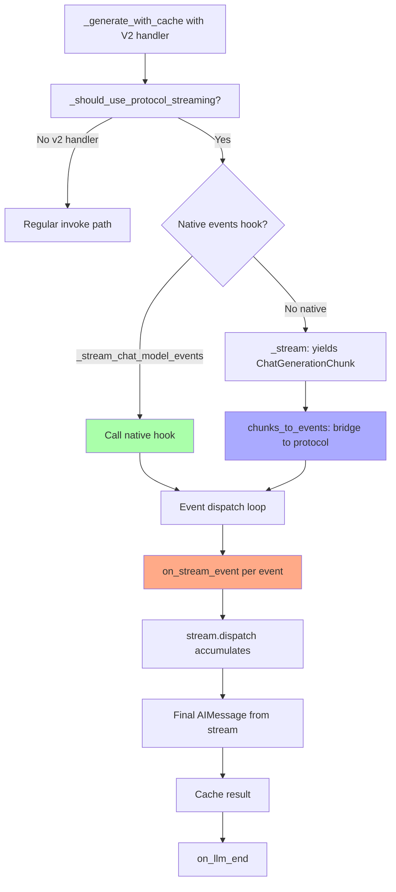

# Chat Models: Core Abstractions and Protocol

Chat models form the core abstraction for conversational AI in LangChain, operating as **message-in, message-out** interfaces. The system consists of:

- **`BaseChatModel`** (in `langchain_core.language_models.chat_models`): The abstract base class defining the contract all implementations must follow.
- **Streaming protocol**: Two complementary modes (V1 callback-based and V2 event-based) for yielding incremental output, with a V3 high-level API for structured streaming.
- **Tool calling and structured output**: Declarative bindings that transform models into function-calling and structured-response systems.
- **Finish reason handling**: Provider-specific raw finish reasons, normalized reason values, and state metadata flow through streaming and caching.
- **Lifecycle and management**: Caching, rate limiting, callback dispatch, and message normalization woven throughout.

## BaseChatModel: The Core Contract

**`BaseChatModel`** is an abstract base class extending both `BaseLanguageModel` and `Runnable`. Every chat model implementation must inherit from it and fulfill a minimal contract:

### Required Overrides

Subclasses **must** implement:

- **`_generate(messages, stop, run_manager, **kwargs) → ChatResult`**: The core synchronous generation method. Receives normalized `BaseMessage` objects and returns a `ChatResult` containing `ChatGeneration` objects with `AIMessage` output and optional `generation_info` metadata.

- **`_llm_type` (property)**: A string identifier for logging and serialization (e.g., `"openai"`, `"anthropic"`, `"bedrock"`).

### Optional Overrides for Performance

Implementations may override to optimize performance:

- **`_stream(messages, stop, run_manager, **kwargs) → Iterator[ChatGenerationChunk]`**: Yields streaming chunks; if not provided, `stream()` falls back to `invoke()`.
- **`_agenerate(messages, stop, run_manager, **kwargs) → ChatResult`**: Native async generation; if not provided, runs `_generate` in an executor.
- **`_astream(messages, stop, run_manager, **kwargs) → AsyncIterator[ChatGenerationChunk]`**: Native async streaming; if not provided, wraps `_stream` in an executor.
- **`_stream_chat_model_events()` / `_astream_chat_model_events()`**: Native v2 event generators; if not provided, v2 streaming bridges through `_stream` / `_astream` via `chunks_to_events()`.

### Optional Overrides for Tracing and Tool Support

- **`_get_ls_params(stop, **kwargs) → LangSmithParams`**: Returns tracing metadata (provider name, model name, temperature, max tokens); each provider overrides to map its model identifiers.
- **`bind_tools(tools, tool_choice, **kwargs)`**: Binds tool schemas; base raises `NotImplementedError`; each provider implements its own conversion.
- **`_resolve_model_profile() → ModelProfile | None`**: Returns capability metadata (context window, modalities, tool support) from partner package data.

## Input/Output Protocol

### Input Normalization

Callers pass `LanguageModelInput` (string, list of messages, or `PromptValue`) to high-level methods (`invoke`, `stream`, `generate`). Internally:

1. **`_convert_input(model_input)`** normalizes input to a `PromptValue`:
   - Strings → `StringPromptValue(text=...)`
   - Message sequences → `ChatPromptValue(messages=...)`
   - Existing `PromptValue` objects → passed through

2. **`_normalize_messages(messages)`** converts `ChatPromptValue` to a list of `BaseMessage` objects for the provider.

3. Each provider then converts `BaseMessage` to its API format at the boundary (e.g., OpenAI role/content dicts, Anthropic content blocks).

### Output Structure: AIMessage

Generated `AIMessage` objects carry:

- **`content`**: String (most common) or list of content blocks (multimodal: text, images, audio, tool calls).
- **`tool_calls`**: List of `ToolCall` objects (id, name, args dict, type="tool_call") if the model performed tool use.
- **`additional_kwargs`**: Provider-specific fields (e.g., refusal, full tool_calls array, Anthropic-specific fields).
- **`response_metadata`**: Response headers, token usage, model name, finish reason metadata, logprobs—parsed from the API response.
- **`usage_metadata`**: Normalized `UsageMetadata` with `input_tokens`, `output_tokens`, `total_tokens`, and optional cost breakdown (`cache_read_tokens`, `cache_creation_tokens`).
- **`id`**: Unique message identifier (typically `"lc-<run_id>-<index>"` for tracing).

The **`output_version`** field controls content storage:

- `None` / `"v0"` (default): Provider-specific format in `content`; `content_blocks` property lazily parses into standard format.
- `"v1"`: Standard format written to `content` directly; `content_blocks` and `content` equivalent.

### Provider-Specific Message Conversion

Each provider implements conversion to its native format:

- **OpenAI** (via `_convert_message_to_dict`): Converts `BaseMessage` to `{"role": "...", "content": "..."}` dicts, with tool_calls extracted from `message.tool_calls` or `additional_kwargs["tool_calls"]`.
- **Anthropic** (via `_convert_message_to_anthropic`): Converts to content blocks (text, images, tool_use), merges tool results into human messages, normalizes tool call IDs to alphanumeric pattern (`^[a-zA-Z0-9_-]+$`).

## Finish Reason Handling

Providers set three finish-related fields in `response_metadata`:

- **`finish_reason`** (raw): The provider's native value (e.g., `"stop"`, `"max_tokens"`, `"pause_turn"`, `"end_turn"`), passed through unchanged.
- **`normalized_finish_reason`** (normalized): A standardized value across providers: `"stop"`, `"length"`, `"tool_call"`, `"refusal"`, or `"other"`.
- **`finish_state`** (optional): Additional state metadata from the provider (e.g., `"suspended"` for Anthropic's `pause_turn`).

**Corrections via `_finish_fields()`**:

The function applies two provider-agnostic corrections to the normalized finish reason:

1. When the message has **tool calls** and normalized reason is `"stop"` → corrected to `"tool_call"`.
2. When the message has a **refusal** content block → corrected to `"refusal"` (overrides `"stop"`).

These corrections account for the fact that tool calls and refusals may arrive in earlier stream chunks than the finish reason itself; they are finalized on the assembled message.

**Streaming and Caching**:

- **V2 events** (`stream_events(version="v3")`): The `message-finish` event carries all three finish fields from `response_metadata`.
- **Cache replay**: When a cached message is replayed as v2 events, the original finish fields are reconstructed and fired normally.
- **Invoke only**: The `invoke()` method returns `response_metadata` unchanged; finish field corrections are applied only during v2 event generation (not during regular invoke/stream).

## Streaming Protocol

Chat models support two complementary streaming modes, triggered by different callback handler types and configuration:

### V1 Streaming: Callback-Based Token Dispatch

Triggered when:
- `_StreamingCallbackHandler` is attached to the run manager, or
- `stream=True` is explicit in call kwargs, or
- `streaming=True` is set on the model instance.

Flow:
1. `stream()` / `astream()` calls `_should_stream()` to decide whether to route through `_stream()` / `_astream()`.
2. Each chunk is a `ChatGenerationChunk` carrying `AIMessageChunk` with incremental content.
3. Chunks are decorated with `response_metadata` and a run ID if missing.
4. `run_manager.on_llm_new_token(content, chunk=chunk)` fires per chunk, enabling real-time display or logging.
5. Chunks are accumulated and merged into a final `ChatGeneration` for caching and `on_llm_end()` callbacks.

A final empty chunk with `chunk_position="last"` signals completion if not yielded by the provider.

### V2 Streaming: Protocol Events

Triggered when a `_V2StreamingCallbackHandler` is attached to the run manager (gates the v2 path even if v1 would also trigger).

Flow:
1. `_generate_with_cache()` / `_agenerate_with_cache()` check `_should_use_protocol_streaming()` and route through `_iter_v2_events()` / `_aiter_v2_events()` if true.
2. The event iterator prefers native `_stream_chat_model_events()` / `_astream_chat_model_events()` hooks if implemented.
3. Otherwise, bridges `_stream()` / `_astream()` chunks via `chunks_to_events()`, translating chunks into standardized protocol events (content-block lifecycle, message structure).
4. Each event fires `run_manager.on_stream_event(event)`, enabling LangGraph integration and structured tracing.
5. Events are accumulated into a final `AIMessage`; result is cached and returned.

**Bypass control**: The `disable_streaming` field suppresses streaming:

- `True`: Always use non-streaming invoke.
- `"tool_calling"`: Use non-streaming only when `tools` keyword is passed.
- `False` (default): Use streaming if available and requested.

### Content Block Streaming and Finalization

V2 events expose content blocks (text, reasoning, tool calls, images, etc.) with a strict lifecycle:

```
message-start
  -> content-block-start (index 0, type, partial metadata)
  -> content-block-delta* (incremental text/args chunks)
  -> content-block-finish (finalized block: merged args, indices)
  -> [repeat for each block]
message-finish
```

The **compat bridge** (`chunks_to_events`) translates `ChatGenerationChunk` streams into this protocol by:

1. **Per-chunk block tracking**: Each chunk's `content_blocks` property returns delta slices (not accumulated state).
2. **Index tracking**: Blocks are keyed by their `index` field (or positional fallback) to correlate chunks belonging to the same block across a stream.
3. **Delta events**: Incremental text/reasoning/args are emitted directly as `content-block-delta` events.
4. **Finalization**: On block closure, `tool_call_chunk` → `tool_call` with args parsed from JSON (or `invalid_tool_call` on parse failure); reasoning and text blocks carry accumulated text; other types are finalized as-is.

**Tool call finalization** via `finalize_tool_call_chunk()`:

When a `tool_call_chunk` accumulates its args across deltas, the final `content-block-finish` event parses them:

- **Success**: Produces a `tool_call` block with `{"id": "...", "name": "...", "args": {...}}`.
- **JSON parse failure**: Produces an `invalid_tool_call` block carrying the raw string and error.

Invalid tool calls are also tracked at the message level in `AIMessage.invalid_tool_calls` for introspection.

### V3 Streaming: Structured API

The `stream_events(version="v3")` and `astream_events(version="v3")` methods return a `ChatModelStream` (or `AsyncChatModelStream`) object that provides typed projections:

- `.text`: Accumulated text content.
- `.reasoning`: Accumulated reasoning content (if supported).
- `.tool_calls`: Accumulated tool calls.
- `.output`: The final `AIMessage`.

This is a **beta** feature providing a more structured streaming API than v1/v2 events. It always produces v1-shaped content blocks regardless of the model's `output_version` setting.

## Tool Calling Integration

### Binding and Schema Conversion

`bind_tools(tools, tool_choice=None, **kwargs)` returns a wrapped `Runnable` that encodes tool information into API calls. Tools are specified as:

- `BaseTool` instances (with `.invoke()` and `args_schema`).
- Pydantic models (with docstrings and field descriptions).
- Plain functions (analyzed for signature and docstring).
- Dictionaries (raw tool schemas in OpenAI format).

The base implementation raises `NotImplementedError`. Each provider overrides to convert tools to its format:

- **OpenAI**: Via `convert_to_openai_tool()` to function schema dicts, sent in `tools` parameter with optional `tool_choice` constraint.
- **Anthropic**: Via `AnthropicTool` TypedDict with `input_schema` (JSON Schema) and optional beta headers for built-in tools (web_fetch, computer_use, etc.).

### Tool Calling in Responses

When bound tools are used, the model returns `AIMessage` with `tool_calls` (list of `ToolCall` objects) in place of or alongside text content. Each `ToolCall` contains:

- `id`: Unique identifier.
- `name`: Tool/function name.
- `args`: Dictionary of argument values (parsed from JSON if necessary).
- `type`: Always `"tool_call"`.

Provider-specific metadata in `additional_kwargs` carries full tool schemas (OpenAI), finish reasons (Anthropic), or other details.

### Structured Output Pattern

`with_structured_output(schema, include_raw=False, **kwargs)` wraps a model to enforce structured responses. The flow:

1. Bind the schema as a single tool with `tool_choice="any"`.
2. Invoke the bound model (tool calling is guaranteed).
3. Parse tool arguments via `JsonOutputToolsParser` (dict) or `PydanticToolsParser` (Pydantic instance).
4. If `include_raw=True`, return `{"raw": message, "parsed": result, "parsing_error": None|exception}`.

Supports Pydantic models, TypedDict classes, JSON schema dicts, and OpenAI function schema dicts.

## Caching and Generation Lifecycle

### Cache Lookup and Hit Handling

Before calling `_generate`, the internal `_generate_with_cache()` method:

1. Serializes message inputs and call parameters into a cache key.
2. Queries the configured cache (instance, global, or none).
3. On **cache hit**, returns cached `ChatGeneration` objects and replays v2 events if a v2 handler is attached (ensuring consistent event streams).
4. On **cache miss** (or no cache), applies rate limiting and proceeds to generation.

Cache entries store full `ChatGeneration` objects, including `AIMessage` with all metadata. On hit, **token cost is zeroed** to reflect no API consumption, but token counts are preserved for tracing.

The `_replay_v2_events_for_cache_hit()` method converts cached `AIMessage` back to protocol events via `message_to_events()`, so LangGraph and event-streaming consumers observe identical behavior whether the response is fresh or cached.

### Rate Limiting

If `rate_limiter` (a `BaseRateLimiter`) is set, `acquire()` or `aacquire()` is called **after** cache lookup but **before** generation, enforcing request pacing at the model level.

### Response Metadata Decoration

After `_generate`, response metadata is augmented:

- **Gateway metadata** (if routed through LangSmith) is parsed from headers and attached to `generation_info`.
- **Token details** (`InputTokenDetails`, `OutputTokenDetails`) are extracted and normalized into `UsageMetadata`.
- **Per-generation message IDs** are assigned if missing (format: `"lc-<run_id>-<index>"`).

## Multi-Batch Generation

### generate() and agenerate()

These methods process lists of message lists:

- `generate(messages: list[list[BaseMessage]], ...)` → `LLMResult` with generations for each message list.
- `agenerate(...)` concurrently invokes `_agenerate_with_cache()` for each message list via `asyncio.gather()`.

Both accept the same kwargs as `invoke` (temperature, max_tokens, stop sequences, etc.), forwarded to `_generate`. Callbacks fire per message list via `on_chat_model_start` with batch size.

### LLMResult and Metadata Combination

The returned `LLMResult` contains:

- `generations`: List of lists of `ChatGeneration` objects (one list per input message list).
- `llm_output`: Combined output from all generations (via `_combine_llm_outputs`, usually `None`).
- `run`: List of `RunInfo` objects (if callbacks were used) linking each generation to its run ID.

## Callback Lifecycle

Model calls fire callback lifecycle events in order:

1. **`on_chat_model_start()`**: Fired before generation; receives serialized model, message list, invocation params.
2. **`on_llm_new_token(content, chunk=chunk)`** (V1 streaming): Fired per chunk during `stream()`/`astream()`.
3. **`on_stream_event(event)`** (V2 streaming): Fired per protocol event during v2 event generation.
4. **`on_llm_end(llm_result)`**: Fired after generation with final `LLMResult`.
5. **`on_llm_error(exception, response)`**: Fired on generation failure with partial `LLMResult` and error details.

Callback configuration is set via the `config` parameter (e.g., `config={"callbacks": handler_list}`) and inherited through chains.

## Tracing and Observability

### LangSmith Integration

`_get_ls_params()` extracts tracing metadata:

- `ls_provider`: Provider name (derived from class name or overridden).
- `ls_model_name`: Model identifier (resolved from `kwargs`, `self.model`, or `self.model_name`).
- `ls_temperature`, `ls_max_tokens`, `ls_stop`: Call parameters.

Subclasses override `_get_ls_params()` to map provider-specific model identifiers (e.g., `model`, `model_name`, `model_id`, `deployment_name`) to the standard `ls_model_name` field.

### Model Profiles

The optional `profile` field carries capability metadata (context window, supported modalities, tool-calling support, structured output capability). Profiles are auto-loaded via `_resolve_model_profile()` from partner package data if not explicitly provided. This enables runtime capability checks and routing decisions.

## Extended: Configurable Models and Runtime Binding

The `init_chat_model()` function (in `langchain_v1.langchain.chat_models.base`) provides unified instantiation across providers without hardcoding imports:

- Accepts prefixed model names (e.g., `"openai:gpt-4o"`) or bare names with provider inference.
- Returns a fixed `BaseChatModel` instance or a configurable proxy (`_ConfigurableModel`) that defers instantiation and applies queued operations (bind_tools, with_structured_output) when invoked with runtime config.

This enables workflows where tool binding and model provider are determined at runtime rather than at code-write time.

### Provider Inference

Model names are inferred to providers via case-insensitive prefix matching in `_attempt_infer_model_provider()`:

- `gpt-`, `o1`, `o3`, `chatgpt`, `text-davinci` → `openai`
- `claude` → `anthropic`
- `command` → `cohere`
- `accounts/fireworks` → `fireworks`
- `gemini` → `google_vertexai` (with deprecation warning; defaults change in next major version)
- `amazon.`, `anthropic.`, `meta.` → `bedrock`
- `mistral`, `mixtral` → `mistralai`
- `deepseek` → `deepseek`
- `grok` → `xai`
- `sonar` → `perplexity`
- `solar` → `upstage`

Inference returns `None` if no prefix matches; in that case `init_chat_model()` raises a `ValueError` with a helpful list of supported providers unless `model_provider` is explicitly specified.

### Built-in Provider Registry

The `_BUILTIN_PROVIDERS` registry maps provider names to module paths, class names, and creator functions, enabling dynamic import and instantiation without explicit imports. Partners can register custom providers by installing their packages (e.g., `langchain-openai`, `langchain-anthropic`).

## Key Entrypoints and Dispatch

The main entrypoints into a chat model's lifecycle are:

| Method | Path | Purpose |
|--------|------|---------|
| `invoke(input, config)` | → `generate_prompt()` → `generate()` → `_generate_with_cache()` | Single message call; returns `AIMessage`. |
| `stream(input, config)` | → `_should_stream()` check → `_stream()` chunks | Streaming call; yields `AIMessageChunk` objects. |
| `generate(messages_list)` | → `_generate_with_cache()` per list | Batch call; returns `LLMResult` with per-list generations. |
| `stream_events(version="v3")` | → `_chat_model_stream_v3()` → `_iter_v2_events()` | Event-based streaming; returns `ChatModelStream`. |
| `bind_tools(tools)` | → provider-specific `bind_tools()` | Tool binding; returns wrapped `Runnable`. |
| `with_structured_output(schema)` | → `bind_tools([schema], tool_choice="any")` → `JsonOutputToolsParser` | Structured output; returns parser-wrapped model. |

All paths converge on `_generate_with_cache()` (or async equivalents), which orchestrates cache lookup, rate limiting, v2 event dispatch, and message decoration before returning the result.

### Invoke Flow (Simplified)



Invoke flow showing cache lookup, generation on miss, and callback dispatch.

### Stream (V1) Flow



V1 streaming flow: decision routing, chunk accumulation, and callback dispatch.

### V2 Event Generation Flow



V2 event generation: routing through native hooks or compat bridge, event dispatch, and caching.
